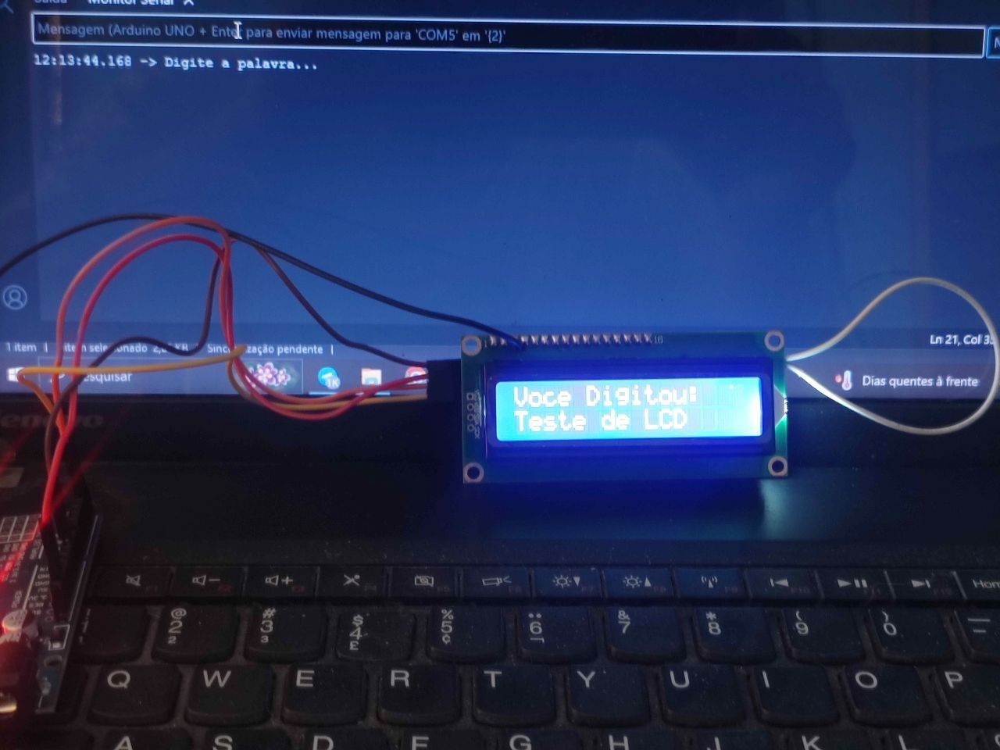

# LCD 16x2 com módulo I2C e Arduino Uno

Projeto de exemplo que recebe uma palavra pelo Monitor Serial e a exibe em um display LCD 16x2 com adaptador I2C. Após mostrar o texto, o LCD apresenta uma tela de créditos.

> Coloque a foto da montagem em `imagens/LCD-I2C.jpg` para que ela apareça acima.

## Componentes

- Arduino Uno
- Display LCD 16x2 com módulo adaptador I2C
- Cabos jumper
- Cabo USB para conectar o Arduino ao computador
- Opcional, se o trimpot de contraste estiver quebrado: resistor de 2 kΩ e jumper para a ligação descrita abaixo

## Ligação dos pinos

Conecte o módulo I2C ao Arduino Uno:

| Módulo I2C | Arduino Uno |
| --- | --- |
| GND | GND |
| VCC | 5V |
| SDA | A4 (SDA) |
| SCL | A5 (SCL) |

No Arduino Uno, SDA e SCL correspondem aos pinos A4 e A5. Confira as marcações da sua placa e do módulo antes de ligar a alimentação.

## Contraste quando o trimpot está quebrado

O trimpot do adaptador ajusta o contraste do LCD. Se ele estiver danificado, o projeto prevê uma alternativa fixa:

1. Com o Arduino desligado, localize no LCD o pino **V0** (entrada de contraste; normalmente é o terceiro pino do LCD, contando da esquerda com a placa de frente).
2. Ligue um jumper ao pino V0.
3. Conecte um resistor de **2 kΩ** entre V0 e **GND** do Arduino.
4. Ligue novamente e teste a visualização. Como o resistor fornece um ajuste fixo, o contraste pode variar conforme o display; se não ficar legível, use um trimpot/potenciômetro substituto adequado em vez de alterar a ligação às cegas.

O jumper mencionado no comentário do código para os pinos/terminais do LED do módulo diz respeito à iluminação de fundo, não ao ajuste do contraste. Faça essa ligação somente se o seu adaptador exigir isso e respeitando suas marcações.

## Como executar

1. Abra `LCD_I2C.ino` na Arduino IDE.
2. Instale a biblioteca **LiquidCrystal_I2C** pelo Gerenciador de Bibliotecas da IDE, caso ainda não esteja instalada.
3. Conecte o Arduino Uno por USB, selecione a placa e a porta serial corretas e carregue o sketch.
4. Abra o **Monitor Serial** e configure a velocidade para **9600 baud**. Escolha o envio de uma nova linha (ou pressione Enter depois de digitar).
5. Digite uma palavra e envie. O LCD mostrará `Voce Digitou:` na primeira linha e o texto recebido na segunda; depois exibirá os créditos e repetirá o processo.

O código usa o endereço I2C `0x27`. Se o seu módulo usar outro endereço, altere o endereço na inicialização do LCD em `LCD_I2C.ino`.

## Funcionamento

- Aguarda uma linha enviada pela porta serial.
- Remove espaços e quebras de linha no início e no fim do texto recebido.
- Exibe o texto por 3 segundos e os créditos por 2 segundos.

A tela tem 16 colunas; textos maiores podem não caber integralmente na linha.
